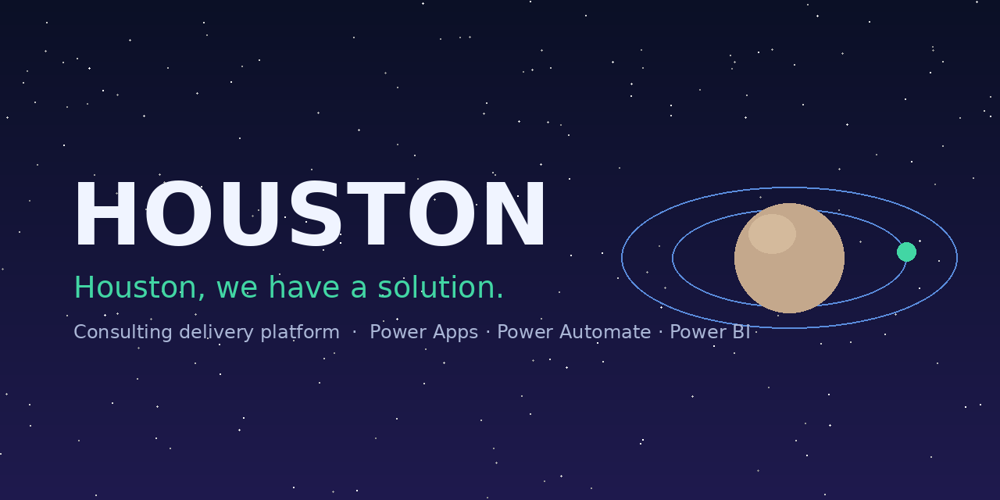

<p align="center">
  
</p>

<h1 align="center">Houston</h1>

<p align="center">
  <a href="https://github.com/DiogoS7/Houston/actions/workflows/ci.yml"></a>
</p>

<p align="center"><em>Houston, we have a solution.</em></p>

A consulting delivery platform built on Microsoft Power Platform. Houston follows an engagement through its whole lifecycle: staffing the team, scoping the work, delivering it and stabilising it after go-live.

## Modules

| Module | What it does | Release |
|---|---|---|
| **Bench** | Consultant staffing, timesheets and utilisation | v1.0 |
| **SkillPath** | Skills matrix and certification tracking | v1.1 |
| **ScopeGuard** | Requirements and change request management | v1.2 |
| **Hypercare** | Post go-live incident tracking with SLAs | v1.3 |
| **Cross-module** | Skill-gap alerts, effort per requirement | v2.0 |

All modules share one Dataverse data model: Consultants, Clients, Engagements and Skills.

## Tech stack

- **Power Apps** (canvas app) – the user interface
- **Microsoft Dataverse** – data model and security
- **Power Automate** – approvals, reminders and alerts
- **Power BI** – utilisation, bench forecast and skills analytics, embedded in the app
- **Power Platform CLI** + **GitHub Actions** – solution source control and CI

## Repository structure

```
├── assets/          README and portfolio images
├── data/            Seed data (fictional) for the Dataverse tables
├── docs/            Business analysis: problem statement, user stories, data model, process flows
│   └── releases/    Release notes per version
├── powerbi/         Power BI report as a Power BI Project (.pbip)
├── screenshots/     Screenshots per release
└── solution/        Unpacked Dataverse solution (source)
```

## Getting started

1. Get a free [Power Apps Developer Plan](https://powerapps.microsoft.com/developerplan) environment.
2. Install the [Power Platform Tools](https://marketplace.visualstudio.com/items?itemName=microsoft-IsvExpTools.powerplatform-vscode) extension for VS Code.
3. Pack and import the solution:
   ```
   pac solution pack --zipfile out/Houston.zip --folder solution
   pac solution import --path out/Houston.zip
   ```
4. Load the CSVs in `data/` into the matching tables.
5. Open `powerbi/` in Power BI Desktop and point the Dataverse connection at your environment.

## Documentation

- [Problem statement](docs/problem-statement.md)
- [User stories](docs/user-stories.md)
- [Data model](docs/data-model.md)
- [Process flows](docs/process-flows.md)
- [Release notes](docs/releases/)

## Author

**Diogo Santos** · [LinkedIn](https://www.linkedin.com/in/diogo-santos-b22801243) · [GitHub](https://github.com/DiogoS7)

## License

[MIT](LICENSE)
