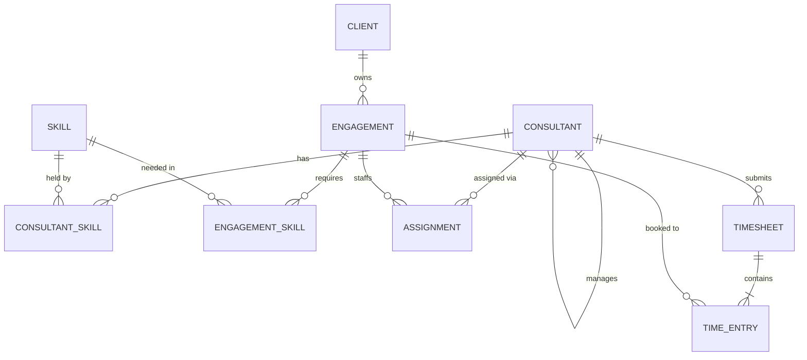

# Data model

All tables live in Dataverse under the publisher prefix `hou_`. The core tables (Consultant, Client, Engagement, Skill) are shared by every module.

## Tables

Every Dataverse table needs a primary name column. For Consultant Skill, Engagement Skill, Assignment and Time Entry, keep the default `hou_name` column and make it an autonumber (e.g. `ASG-{SEQNUM:5}`).

### Consultant (`hou_consultant`)
| Column | Type | Notes |
|---|---|---|
| hou_name | Text | Full name (primary column) |
| hou_email | Email | |
| hou_grade | Choice | Analyst, Consultant, Senior Consultant, Manager |
| hou_practice | Choice | Power Platform, Salesforce, Data & AI, Business Analysis |
| hou_targetutilisation | Whole number | Target billable %, e.g. 80 |
| hou_manager | Lookup → Consultant | |

### Client (`hou_client`)
| Column | Type | Notes |
|---|---|---|
| hou_name | Text | Primary column |
| hou_industry | Choice | Banking, Insurance, Retail, Public Sector, Utilities |
| hou_country | Text | |

### Engagement (`hou_engagement`)
| Column | Type | Notes |
|---|---|---|
| hou_name | Text | Primary column |
| hou_client | Lookup → Client | |
| hou_startdate / hou_enddate | Date | |
| hou_status | Choice | Pipeline, Active, Closed |
| hou_billable | Yes/No | Internal projects are non-billable |

### Skill (`hou_skill`)
| Column | Type | Notes |
|---|---|---|
| hou_name | Text | Primary column |
| hou_category | Choice | Technical, Functional, Platform |

### Consultant Skill (`hou_consultantskill`)
| Column | Type | Notes |
|---|---|---|
| hou_consultant | Lookup → Consultant | |
| hou_skill | Lookup → Skill | |
| hou_proficiency | Whole number | 1–5 |
| hou_lastused | Date | |

### Engagement Skill (`hou_engagementskill`)
| Column | Type | Notes |
|---|---|---|
| hou_engagement | Lookup → Engagement | |
| hou_skill | Lookup → Skill | |
| hou_requiredlevel | Whole number | 1–5 |
| hou_headcount | Whole number | |

### Assignment (`hou_assignment`)
| Column | Type | Notes |
|---|---|---|
| hou_consultant | Lookup → Consultant | |
| hou_engagement | Lookup → Engagement | |
| hou_allocation | Whole number | % of the working week |
| hou_startdate / hou_enddate | Date | |

### Timesheet (`hou_timesheet`)
| Column | Type | Notes |
|---|---|---|
| hou_name | Text | Primary column, e.g. "Ana Lopes – 2026-10-05" |
| hou_consultant | Lookup → Consultant | |
| hou_weekstart | Date | Monday of the week |
| hou_status | Choice | Draft, Submitted, Approved, Rejected |
| hou_approver | Lookup → Consultant | Set by the approval flow |
| hou_decisiondate | Date and time | |
| hou_comment | Multiline text | Rejection reason |

### Time Entry (`hou_timeentry`)
| Column | Type | Notes |
|---|---|---|
| hou_timesheet | Lookup → Timesheet | Parent (cascade delete) |
| hou_engagement | Lookup → Engagement | |
| hou_date | Date | |
| hou_hours | Decimal | 0–12 |
| hou_billable | Yes/No | Defaults from the engagement |

## Key calculations (Power BI)

- **Billable utilisation %** = billable hours ÷ (40 × weeks) for approved timesheets
- **Forecast allocation** = sum of active assignment allocations per consultant per future week
- **Bench gap** = target utilisation − forecast allocation (when positive)
