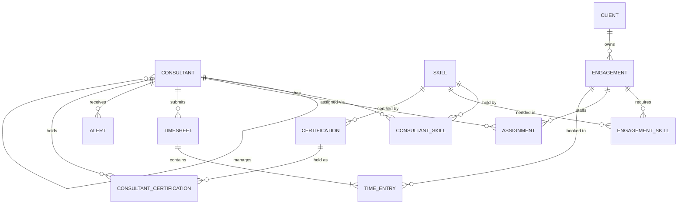

# Data model

All tables live in Dataverse under the publisher prefix `hou_`. The core tables (Consultant, Client, Engagement, Skill) are shared by every module.

Tables added in **v1.1 (SkillPath)**: Certification and Consultant Certification. Consultant gains a *Skills Reviewed* date, and Alert gains two alert types.

## Tables

Every Dataverse table needs a primary name column. For Consultant Skill, Engagement Skill, Assignment and Time Entry, keep the default `hou_name` column and make it an autonumber (e.g. `ASG-{SEQNUM:5}`).

### Consultant (`hou_consultant`)
| Column | Type | Notes |
|---|---|---|
| hou_name | Text | Full name (primary column) |
| hou_email | Email | |
| hou_grade | Choice | Analyst, Consultant, Senior Consultant, Manager |
| hou_practice | Choice | Power Platform, Salesforce, Data & AI, Business Analysis |
| hou_targetutilisation | Whole number | Target billable %, e.g. 80 |
| hou_manager | Lookup → Consultant | |
| hou_skillsreviewed | Date | *v1.1.* Last time the consultant reviewed their skills |

### Client (`hou_client`)
| Column | Type | Notes |
|---|---|---|
| hou_name | Text | Primary column |
| hou_industry | Choice | Banking, Insurance, Retail, Public Sector, Utilities |
| hou_country | Text | |

### Engagement (`hou_engagement`)
| Column | Type | Notes |
|---|---|---|
| hou_name | Text | Primary column |
| hou_client | Lookup → Client | |
| hou_startdate / hou_enddate | Date | |
| hou_status | Choice | Display name "Engagement Status": Pipeline, Active, Closed |
| hou_billable | Yes/No | Internal projects are non-billable |

### Skill (`hou_skill`)
| Column | Type | Notes |
|---|---|---|
| hou_name | Text | Primary column |
| hou_category | Choice | Technical, Functional, Platform |

### Consultant Skill (`hou_consultantskill`)
| Column | Type | Notes |
|---|---|---|
| hou_consultant | Lookup → Consultant | |
| hou_skill | Lookup → Skill | |
| hou_proficiency | Whole number | 1–5 |
| hou_lastused | Date | |

### Engagement Skill (`hou_engagementskill`)
| Column | Type | Notes |
|---|---|---|
| hou_engagement | Lookup → Engagement | |
| hou_skill | Lookup → Skill | |
| hou_requiredlevel | Whole number | 1–5 |
| hou_headcount | Whole number | |

### Assignment (`hou_assignment`)
| Column | Type | Notes |
|---|---|---|
| hou_consultant | Lookup → Consultant | |
| hou_engagement | Lookup → Engagement | |
| hou_allocation | Whole number | % of the working week |
| hou_startdate / hou_enddate | Date | |

### Timesheet (`hou_timesheet`)
| Column | Type | Notes |
|---|---|---|
| hou_name | Text | Primary column, e.g. "Ana Lopes – 2026-10-05" |
| hou_consultant | Lookup → Consultant | |
| hou_weekstart | Date | Monday of the week |
| hou_status | Choice | Display name "Approval Status": Draft, Submitted, Approved, Rejected |
| hou_approver | Lookup → Consultant | Set by the approval flow |
| hou_decisiondate | Date and time | |
| hou_comment | Multiline text | Rejection reason |

### Time Entry (`hou_timeentry`)
| Column | Type | Notes |
|---|---|---|
| hou_timesheet | Lookup → Timesheet | Parent (cascade delete) |
| hou_engagement | Lookup → Engagement | |
| hou_date | Date | |
| hou_hours | Decimal | 0–12 |
| hou_billable | Yes/No | Defaults from the engagement |

### Alert (`hou_alert`)
In-app notifications written by the flows and shown on the Home screen. (Named Alert to avoid clashing with Dataverse's built-in Notification table.)

| Column | Type | Notes |
|---|---|---|
| hou_name | Text | Title (primary column) |
| hou_message | Multiline text | |
| hou_type | Choice | Display name "Alert Type": Timesheet reminder, Bench alert, Approval; *v1.1:* Certification, Skills review |
| hou_isread | Yes/No | Display name "Is Read", default No |
| hou_recipient | Lookup → Consultant | Who sees the alert |

### Certification (`hou_certification`) – v1.1
The catalogue of certifications the firm tracks.

| Column | Type | Notes |
|---|---|---|
| hou_name | Text | Primary column, e.g. "PL-200 Power Platform Functional Consultant" |
| hou_code | Text | Exam or credential code, e.g. PL-200 |
| hou_vendor | Choice | Microsoft, Salesforce, Scrum.org, IIBA, Other |
| hou_level | Choice | Display name "Certification Level": Fundamentals, Associate, Expert, Professional |
| hou_validitymonths | Whole number | Months before renewal is due; 0 = no expiry |
| hou_skill | Lookup → Skill | The main skill the certification proves |

### Consultant Certification (`hou_consultantcertification`) – v1.1
| Column | Type | Notes |
|---|---|---|
| hou_name | Autonumber | `CC-{SEQNUM:5}` |
| hou_consultant | Lookup → Consultant | |
| hou_certification | Lookup → Certification | |
| hou_status | Choice | Display name "Certification Status": Planned, In progress, Passed, Expired |
| hou_targetdate | Date | Planned exam date |
| hou_achieveddate | Date | Date passed |
| hou_expirydate | Date | Set by the verification flow: achieved date + validity months |
| hou_verified | Yes/No | Set to Yes when the manager approves; default No |
| hou_badgeurl | Text (URL) | Link to the badge or transcript |

## Key calculations (Power BI)

- **Billable utilisation %** = billable hours ÷ (40 × weeks) for approved timesheets
- **Forecast allocation** = sum of active assignment allocations per consultant per future week
- **Bench gap** = target utilisation − forecast allocation (when positive)
- *v1.1:* **Certification coverage** = consultants with a verified, unexpired certification ÷ consultants in the practice
- *v1.1:* **Expiring soon** = passed certifications with an expiry date in the next 60 days
