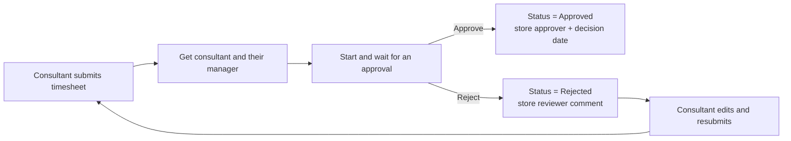
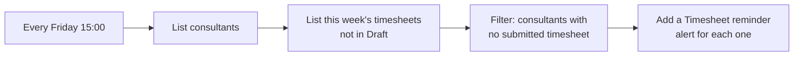
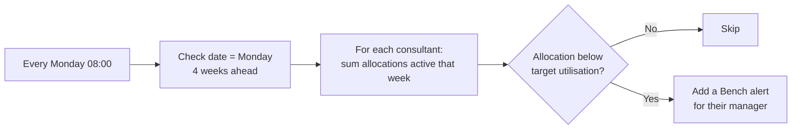
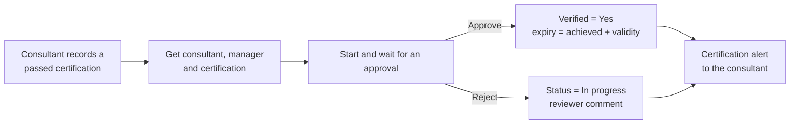
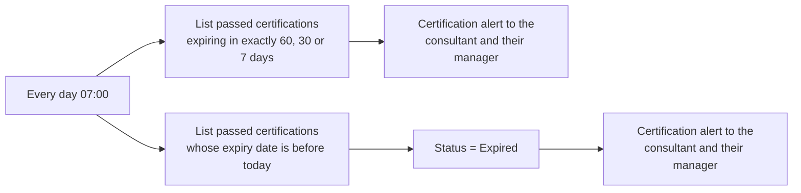
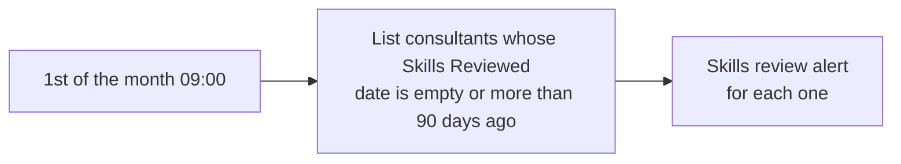

# Process flows

All three flows live in the Houston solution and use the Dataverse connector. Notifications are written to the **Alert** table and appear in the Home screen's notification panel (no mailbox is needed).

## v1.0 – Bench

### 1. Timesheet approval

**Flow:** Houston - Timesheet approval
**Trigger:** a timesheet's Approval Status changes to Submitted.

Approval requests are answered in Power Automate → **Approvals** (or the Teams Approvals app).

### 2. Friday timesheet reminder

**Flow:** Houston - Friday timesheet reminder
**Trigger:** scheduled, every Friday at 15:00 (Europe/Lisbon).

### 3. Weekly bench alert

**Flow:** Houston - Weekly bench alert
**Trigger:** scheduled, every Monday at 08:00 (Europe/Lisbon).

The loop runs with concurrency 1 so the running Allocation total isn't shared between consultants.

## v1.1 – SkillPath

### 4. Certification verification

**Flow:** Houston - Certification verification
**Trigger:** a consultant certification's status changes to Passed while Verified is No.

If the certification's validity is 0, the expiry date is left empty (it never expires).

### 5. Certification expiry check

**Flow:** Houston - Certification expiry check
**Trigger:** scheduled, every day at 07:00 (Europe/Lisbon).

Checking exact day counts once a day means each person gets three warnings and never the same one twice.

### 6. Skills review reminder

**Flow:** Houston - Skills review reminder
**Trigger:** scheduled, on the 1st of every month at 09:00 (Europe/Lisbon).

Saving skills on the *My Skills* screen sets Skills Reviewed to today, so the reminder stops on its own.
