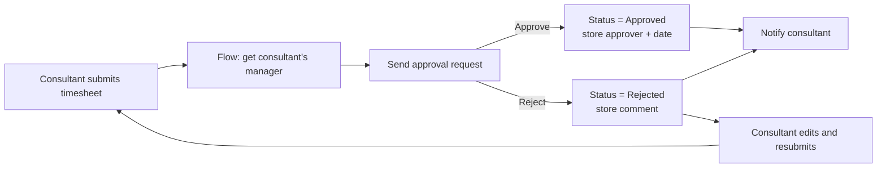
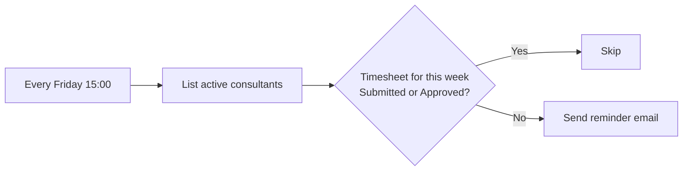
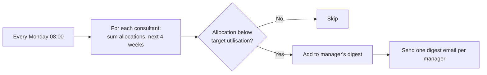

# Process flows – v1.0 (Bench)

## 1. Timesheet approval

**Trigger:** a timesheet's status changes to Submitted.

## 2. Friday timesheet reminder

**Trigger:** scheduled, every Friday at 15:00 (Europe/Lisbon).

## 3. Weekly bench alert

**Trigger:** scheduled, every Monday at 08:00 (Europe/Lisbon).

