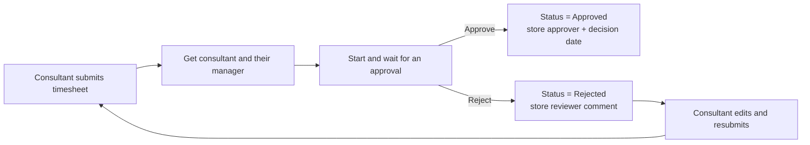
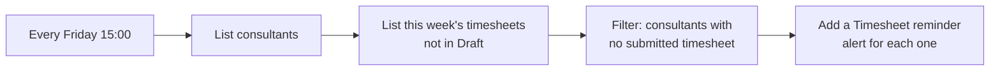
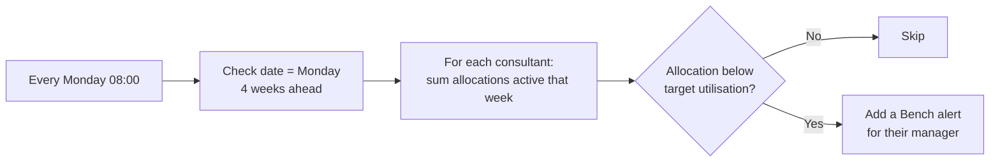

# Process flows – v1.0 (Bench)

All three flows live in the Houston solution and use the Dataverse connector. Notifications are written to the **Alert** table and appear in the Home screen's notification panel (no mailbox is needed).

## 1. Timesheet approval

**Flow:** Houston - Timesheet approval
**Trigger:** a timesheet's Approval Status changes to Submitted.

Approval requests are answered in Power Automate → **Approvals** (or the Teams Approvals app).

## 2. Friday timesheet reminder

**Flow:** Houston - Friday timesheet reminder
**Trigger:** scheduled, every Friday at 15:00 (Europe/Lisbon).

## 3. Weekly bench alert

**Flow:** Houston - Weekly bench alert
**Trigger:** scheduled, every Monday at 08:00 (Europe/Lisbon).

The loop runs with concurrency 1 so the running Allocation total isn't shared between consultants.
